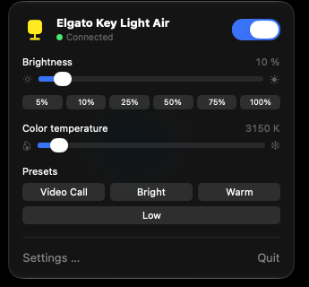
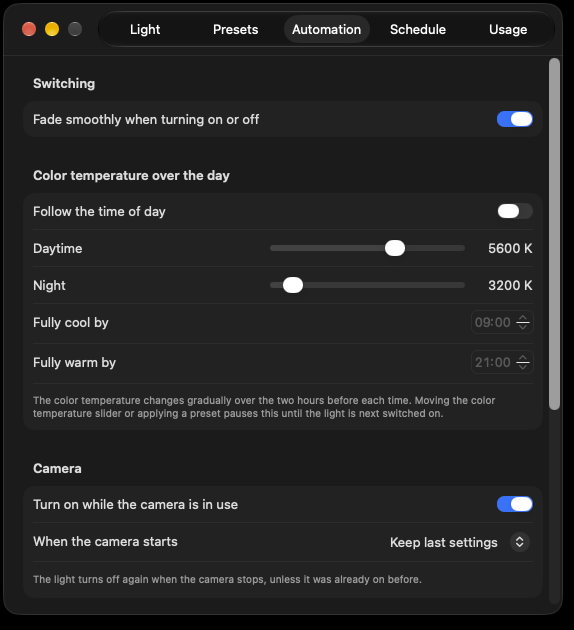

# BetterKeyLight

**A native macOS app** that lives in the menu bar and controls an Elgato Key Light or Key Light Air over its local HTTP API. No Elgato Control Center required.

Requires macOS 14 (Sonoma) or later. There is no version for Windows, Linux, iOS or Android.

<p align="center">
  
</p>

<p align="center">
  
</p>

## Features

- **Menu bar control** – on/off switch, brightness (3–100 %) with quick buttons from 5 % to 100 %, and color temperature (2900–7000 K). The menu bar icon is filled while the light is on.
- **Automatic discovery** – finds Key Lights on your network via Bonjour and sets itself up with the first one it sees. If the light later gets a new IP address, the app follows it. A manual address is still possible.
- **Presets** – save combinations of brightness and color temperature and apply them with one click from the menu.
- **Camera coupling** – turns the light on while any app uses the camera and off again afterwards, optionally with a preset. A light that was already on is left alone.
- **Sleep handling** – turns the light off when the Mac sleeps or the screen locks, and optionally back on after waking or unlocking.
- **Day cycle** – lets the color temperature follow the time of day: cool during the day, warm at night, with a gradual transition.
- **Idle switch-off** – turns the light off after a set time without keyboard or mouse input (not while the camera is in use), and back on when you return.
- **Usage statistics** – shows how long the light was on today and over the last two weeks.
- **Smooth fade** – ramps the brightness when switching on or off instead of cutting hard.
- **Schedule** – any number of rules (time, weekdays, on/off, optional brightness), with a "run now" button.
- **Device info** – product, name, serial number, firmware and MAC address in Settings.
- **Launch at login**.

Camera coupling, sleep handling, idle switch-off and the day cycle are off by default; enable them under Settings → Automation.

## Download

Get `BetterKeyLight-<version>.zip` from the [Releases](https://github.com/removogel/BetterKeyLight/releases) page, unzip it and drag `BetterKeyLight.app` to `/Applications`. The app runs on Apple silicon and Intel Macs.

The app is not notarized by Apple, so macOS blocks the first launch. Open it once, dismiss the warning, then go to System Settings → Privacy & Security and click "Open Anyway".

## Build from source

```bash
./build.sh
```

This produces `build/BetterKeyLight.app`. Only the Xcode Command Line Tools are required.

Every push to `main` and every published release is also built by GitHub Actions; a release gets the app attached automatically.

## Notes

- The first time the app talks to the light, macOS may ask for permission to access the local network. Please allow it, otherwise neither discovery nor control will work.
- Camera coupling only checks whether a camera is in use. It never accesses the camera image and needs no camera permission.
- Schedule rules only run while the app is running and the Mac is awake. After waking, rules missed by up to 10 minutes are caught up.
- The light's state is polled every 15 seconds so changes made elsewhere show up in the app.
- Usage time is only counted while the app is running.
- The app controls one light at a time.

BetterKeyLight is an independent project and is not affiliated with Elgato or Corsair.
